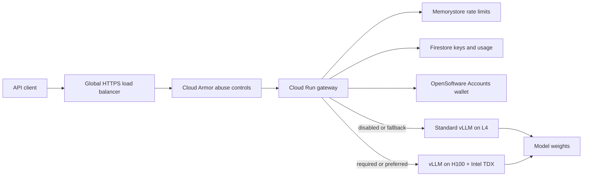

# Architecture

## Runtime path

The gateway is the policy enforcement point. Public model IDs are decoupled from Hugging Face/vLLM model IDs, and each public model declares its permitted backends. A request marked `required` can select only the confidential backend. This invariant is covered by tests. The edge rate limit is availability protection only; authenticated per-key limits and spend reservations remain authoritative in the gateway.

## Trust boundaries

- Certificate Manager terminates public TLS at the global load balancer. Cloud Armor applies an approximate source-IP throttle without inspecting prompt bodies. Cloud Run ingress rejects direct internet paths after edge cutover.
- The gateway authenticates tenant keys, applies request limits, makes the privacy decision, and streams bytes. It intentionally has no prompt database.
- Standard vLLM nodes protect data at rest and in transit but do not provide memory encryption against the cloud/hypervisor boundary.
- Confidential H100 nodes use Confidential GKE Nodes with Intel TDX. Their manifest requires the `TDX` node label as well as the H100 GPU label.
- vLLM services are private ClusterIP endpoints isolated by NetworkPolicy. Do not pass backend API keys on the vLLM command line because vLLM logs non-default startup arguments.
- Secret Manager stores bootstrap secrets. In production, mount secrets through the GKE Secret Manager add-on or External Secrets instead of copying them into static manifests.

## Why one GKE Standard cluster

A Standard cluster permits separate ordinary L4 and confidential H100 node pools while keeping service discovery private. It also makes the TDX requirement visible in both Terraform and pod scheduling. The H100 pool is Spot because that is a current GCP requirement for manually configured confidential GPU node pools; applications therefore need at least two zones/pools for a meaningful availability target.

For stronger organizational isolation, move confidential serving to a separate project and cluster. The API routing/config contract does not change.

## Control plane

OpenSoftware Accounts owns user identity and the Credit wallet. Firestore owns SHA-256 API-key records, revocation, expiration, spend reservations, and immutable usage events. Memorystore owns short-lived distributed request counters. None of these stores prompt or completion text.

GitHub Actions obtains short-lived GCP credentials through Workload Identity Federation. The provider accepts only the immutable numeric repository and organization IDs on `refs/heads/main`; no service-account key is stored in GitHub. A private IAM-gated canary service validates the exact image digest against Redis, Firestore, and authenticated model discovery before the digest is deployed to production.
