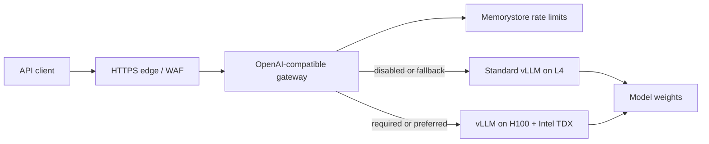

# Architecture

## Runtime path

The gateway is the policy enforcement point. Public model IDs are decoupled from Hugging Face/vLLM model IDs, and each public model declares its permitted backends. A request marked `required` can select only the confidential backend. This invariant is covered by tests.

## Trust boundaries

- The edge terminates public TLS and applies volumetric protection. It must not log request bodies.
- The gateway authenticates tenant keys, applies request limits, makes the privacy decision, and streams bytes. It intentionally has no prompt database.
- Standard vLLM nodes protect data at rest and in transit but do not provide memory encryption against the cloud/hypervisor boundary.
- Confidential H100 nodes use Confidential GKE Nodes with Intel TDX. Their manifest requires the `TDX` node label as well as the H100 GPU label.
- vLLM services are private ClusterIP endpoints isolated by NetworkPolicy. Do not pass backend API keys on the vLLM command line because vLLM logs non-default startup arguments.
- Secret Manager stores bootstrap secrets. In production, mount secrets through the GKE Secret Manager add-on or External Secrets instead of copying them into static manifests.

## Why one GKE Standard cluster

A Standard cluster permits separate ordinary L4 and confidential H100 node pools while keeping service discovery private. It also makes the TDX requirement visible in both Terraform and pod scheduling. The H100 pool is Spot because that is a current GCP requirement for manually configured confidential GPU node pools; applications therefore need at least two zones/pools for a meaningful availability target.

For stronger organizational isolation, move confidential serving to a separate project and cluster. The API routing/config contract does not change.

## Control plane to add next

The production control plane should own tenants, hashed API-key records, model catalog versions, immutable usage events, quotas, invoices, and revocation. Keep it out of the prompt data path. Usage events should contain tenant, model, token counts, latency, status, and compute class—never prompt or completion text.
